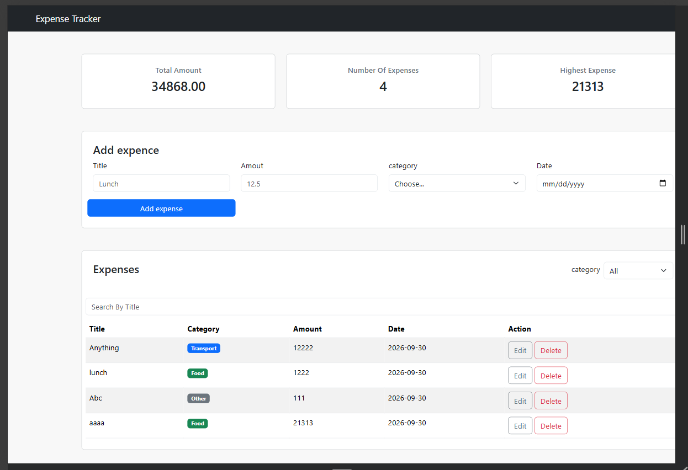
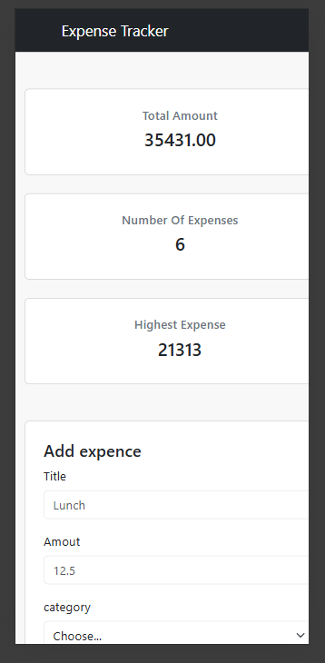

# Expense Tracker

Expense Tracker is a web application for managing personal expenses. It allows users to add, edit, delete, search, and filter expenses, while storing all data in a PostgreSQL database and displaying useful summary information and a chart.

## How to run

### **Backend**

1. Open the project folder in VS Code.
2. Open a terminal in the backend folder.
3. Install the required packages:

```bash
npm install
````

4. Create a PostgreSQL database named:

```text
expense_tracker
```

5. Open `schema.sql` in PostgreSQL and run it on the `expense_tracker` database to create the table and insert the sample expenses.

6. Create a `.env` file in the backend folder:

```env
DB_HOST=localhost
DB_PORT=5432
DB_USER=postgres
DB_PASSWORD=your_postgresql_password
DB_NAME=expense_tracker
PORT=3000
```

7. Replace `your_postgresql_password` with your PostgreSQL password.

8. Start the backend server:

```bash
node server.js
```

9. The backend should be running at:

```text
http://localhost:3000
```

### **Frontend**

1. Make sure the backend server is running.
2. Open the frontend `index.html` file in VS Code.
3. Use **Live Server** to open the page in your browser.
4. The frontend will connect to the backend API at:

```text
http://localhost:3000/api/expenses
```

## Features

* [x] Add an expense (with validation)
* [x] Delete an expense
* [x] Edit an expense
* [x] Filter by category
* [x] Summary cards (total, count, highest)
* [x] Data is saved in a PostgreSQL database
* [x] **Bonus** Search expenses by title

## Screenshots







## What was the hardest part?

The hardest part was dealing with the differences between data types in PostgreSQL and JavaScript. In particular, handling numbers and dates between the database, backend, and frontend caused some issues. For example, PostgreSQL can return numeric values in a different format than JavaScript expects Like to handle the `DATE` and `Amount` value correctly when sending it through the API and displaying it in the frontend. Understanding how the data changes between PostgreSQL, Node.js, JSON, and JavaScript


## github repo: 
https://github.com/AbdShahrour/First-Project-Expenses-tracker


## Demo : ( video )
https://drive.google.com/file/d/1qBSywbTv5GNI6X8Luf79Vapj-laOvFSQ/view?usp=sharing 
